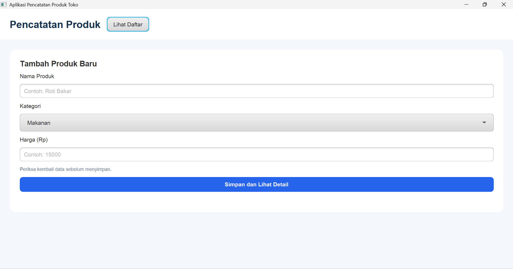
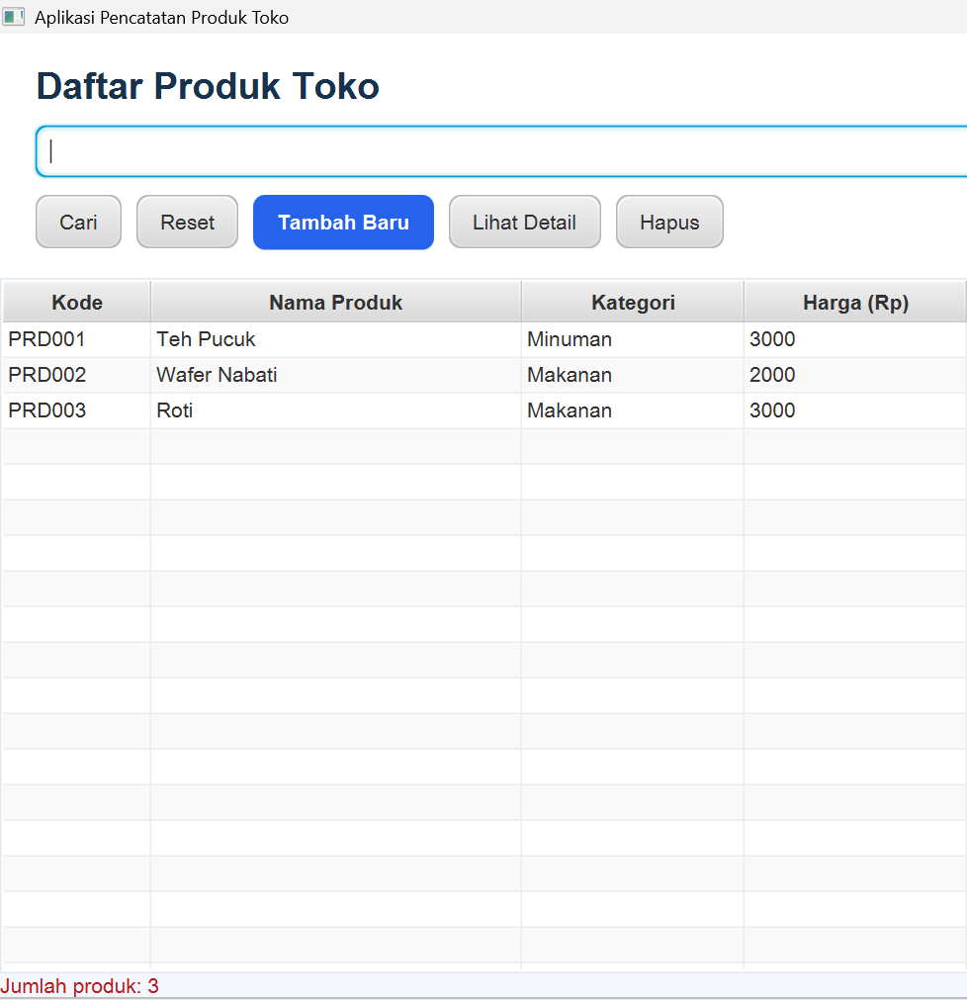
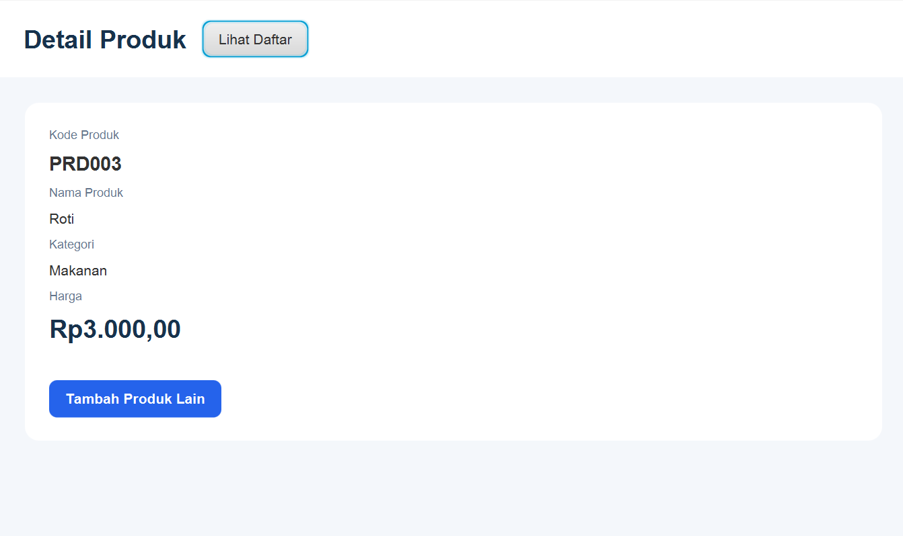

# Aplikasi Pencatatan Produk Toko (JavaFX GUI - Level 2)

Proyek ini adalah modifikasi dari aplikasi praktikum pengantar JavaFX GUI menjadi aplikasi **Pencatatan Produk Toko**. Aplikasi ini dibangun menggunakan JavaFX dengan pola arsitektur MVC (Model-View-Controller) tanpa memerlukan *database* eksternal (penyimpanan sementara di memori).

## 🚀 Fitur Utama
1. **Form Tambah Produk:** 
   * Input nama produk (wajib diisi).
   * Input kategori produk (Makanan / Minuman).
   * Input harga produk (wajib lebih dari nol).
2. **Tabel Daftar Produk:** Menampilkan seluruh produk yang tersimpan dalam format tabel (Kode, Nama, Kategori, Harga).
3. **Pencarian Produk:** Fitur pencarian produk berdasarkan nama menggunakan kolom pencarian.
4. **Detail Produk:** Halaman khusus untuk melihat detail spesifik dari produk yang dipilih pada tabel.
5. **Hapus Produk:** Fitur untuk menghapus produk dari tabel dengan dialog konfirmasi.

## 🛠️ Teknologi yang Digunakan
* **Bahasa:** Java 17
* **Framework GUI:** JavaFX 21
* **Build Tool:** Maven
* **UI Designer:** Scene Builder (File FXML)

## 📁 Struktur Proyek
* `kelas.model`: Berisi *class* `Produk` dengan atribut dan validasi.
* `kelas.data`: Berisi *class* `DataProduk` untuk manajemen daftar (ObservableList).
* `kelas.controller`: Berisi *controller* untuk masing-masing *view* (`FormController`, `DaftarController`, `DetailController`).
* `resources/kelas`: Berisi file FXML untuk antarmuka pengguna dan CSS untuk *styling*.

## 📸 Screenshot Aplikasi

**1. Form Tambah Produk**


**2. Halaman Daftar Produk & Pencarian**


**3. Halaman Detail Produk**


## 💻 Cara Menjalankan Aplikasi
Pastikan Maven sudah terinstal dan terkonfigurasi. Jalankan perintah berikut pada terminal di dalam direktori proyek:
```bash
mvn clean javafx:run